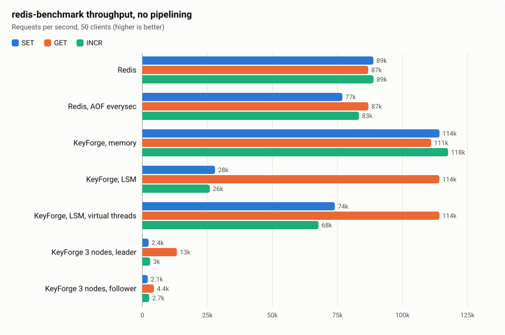
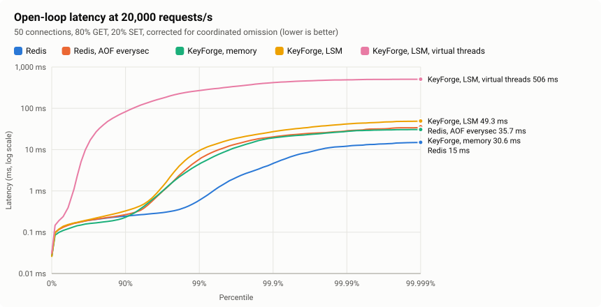
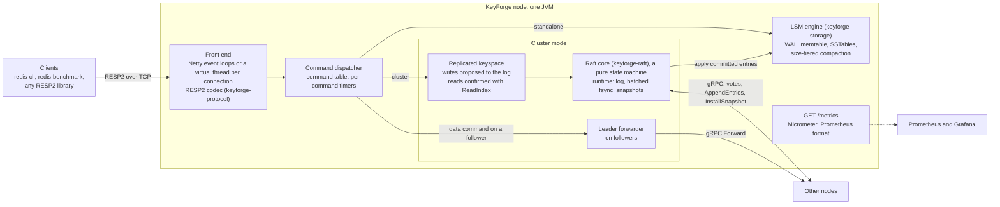

# KeyForge

KeyForge is a distributed key-value store written from scratch in Java 25. It speaks the Redis RESP2 protocol, so
`redis-cli`, `redis-benchmark` and Redis client libraries work against it unchanged. Underneath are its own LSM-tree
storage engine (write-ahead log, memtable, SSTables, compaction) and its own Raft implementation (PreVote, ReadIndex
reads, snapshots, forwarding to the leader), with no storage or consensus library. It is tested the way databases are:
property tests against models, crash tests that kill writing processes, 10,000 seeds of a deterministic Raft simulator
in every build, and a Jepsen-style linearizability test under partitions, kills and packet loss, checked by Porcupine.
Next to Redis 8 on the same machine, one KeyForge node serves more unpipelined requests at the same median latency by
using two cores, while it spends more CPU per request and pays for garbage collection in its tail
([the comparison](docs/benchmarks/keyforge-vs-redis.md)).

> **Status: Phase 6 of 7 complete.** RESP2 protocol, two interchangeable network front ends (Netty and virtual
> threads), a durable LSM-tree storage engine whose data survives `kill -9`, and Raft consensus with linearizable reads
> and writes, verified under faults by a Jepsen-style test. Phase 6 adds the benchmark against real Redis, Prometheus
> metrics with a Grafana dashboard, and a `docker compose up` quick start (see
> [Phase 6 verification](#phase-6-verification)).



Without pipelining, a KeyForge node in memory serves 111–121k requests per second on two vCPUs, against 60–89k for Redis
on its single thread, but spends 1.0–1.3× Redis's CPU per request (1.3–2.3× with a pipeline of 16). Durable writes
behind the virtual-thread front end come within 4–7% of Redis with an append-only file; behind Netty, they are a third
of that. A three-node cluster on the same two vCPUs commits about 2,000 writes per second.



At 20,000 requests per second, measured from each request's intended send time, the medians are equal (0.13–0.17 ms).
In a typical second Redis's p99 is 0.45–0.65 ms and KeyForge's 2.7–7.3 ms, mostly GC pauses. Tails beyond that are
dominated by this desktop's jitter and differ between runs; the LSM engine with virtual threads stalled in this pass
and not in the other. Both passes, CPU accounting and JFR profiles:
[docs/benchmarks/keyforge-vs-redis.md](docs/benchmarks/keyforge-vs-redis.md).

## Quick start

You need Docker, nothing else:

```bash
docker compose up -d
```

The first run builds the server image from source, which takes a few minutes. Then the root
[`docker-compose.yml`](docker-compose.yml) runs:

- a three-node Raft cluster, `kf1`, `kf2` and `kf3`, on host ports 6379, 6380 and 6381;
- Prometheus at <http://localhost:9090>, scraping every node's `/metrics` every 5 seconds;
- Grafana at <http://localhost:3000>, with the KeyForge dashboard as its home page (anonymous viewer; `admin`/`admin`
  to edit).

Any node accepts any command, because followers forward to the leader:

```bash
redis-cli -p 6380 SET hello world
redis-cli -p 6381 GET hello
redis-cli -p 6379 INFO raft
```

Without a local `redis-cli`, use the one in the Redis image:

```bash
docker run --rm --network keyforge-quickstart_default redis:8 redis-cli -h kf2 SET hello world
```

To give the dashboard something to show, start some `redis-benchmark` traffic, then stop everything and delete the data:

```bash
docker compose --profile load up -d load
```

```bash
docker compose --profile load down -v
```

## Architecture



- **Front end.** Two interchangeable servers share the codec and the dispatcher: Netty, or one virtual thread per
  connection ([ADR 0002](docs/adr/0002-threading-model-and-in-memory-store.md),
  [ADR 0005](docs/adr/0005-virtual-thread-server-and-pinning.md)).
- **Storage.** On a standalone node, writes go to the LSM engine's write-ahead log and memtable on one writer thread,
  and reads take no lock ([ADR 0006](docs/adr/0006-lsm-storage-engine.md)). The in-memory engine is the alternative.
- **Replication.** In a cluster the Raft log is the only write-ahead log. Committed entries are applied to the LSM
  engine, which records the last applied index ([ADR 0009](docs/adr/0009-raft-as-a-pure-state-machine.md),
  [ADR 0012](docs/adr/0012-no-double-wal.md)). The Raft core never does I/O itself, which is what lets the
  deterministic simulator test it ([ADR 0013](docs/adr/0013-deterministic-simulation-testing.md)).

## Build

You need JDK 25. The Maven wrapper downloads Maven 3.9.16 on first use.

```bash
./mvnw verify
```

`verify` runs unit tests, jqwik property tests and the integration tests (both real servers on both storage engines,
driven by Jedis and by raw sockets; crash tests that kill writing processes; short load-generator and JMH runs; the
10,000-seed Raft simulation; Raft clusters over real gRPC; the linearizability workload against in-process nodes that
are killed and restarted; the `/metrics` endpoint scraped over HTTP, and the Grafana dashboard checked against the
metrics a node exports). It then builds three jars:

- `keyforge-server/target/keyforge-server-0.1.0-SNAPSHOT-all.jar`;
- `keyforge-bench/target/keyforge-bench-0.1.0-SNAPSHOT-all.jar` (load generator and JMH benchmarks);
- `keyforge-chaos/target/keyforge-chaos-0.1.0-SNAPSHOT-all.jar` (the linearizability test's runner).

The Docker-based tests (`keyforge-chaos/scripts`) and benchmarks (`keyforge-bench/scripts`) stay outside `verify`, and
so do the Go checker's tests, which run when its image is built.

## Run

```bash
java -jar keyforge-server/target/keyforge-server-0.1.0-SNAPSHOT-all.jar
```

Configuration comes from defaults, then an optional properties file (`--config <file>`), then environment variables,
then command-line overrides:

| Property | Environment variable | Default | Meaning |
| --- | --- | --- | --- |
| `node.id` | `KEYFORGE_NODE_ID` | `node-1` | Name in every log line (MDC `nodeId`) |
| `server.bind` | `KEYFORGE_SERVER_BIND` | `0.0.0.0` | Listen address |
| `server.port` | `KEYFORGE_SERVER_PORT` | `6379` | Listen port |
| `server.type` | `KEYFORGE_SERVER_TYPE` | `netty` | Front end: `netty` or `virtual-threads` |
| `server.io-threads` | `KEYFORGE_SERVER_IO_THREADS` | `0` | Netty event loops (0 = 2 × CPUs); ignored by `virtual-threads` |
| `protocol.max-bulk-length` | `KEYFORGE_PROTOCOL_MAX_BULK_LENGTH` | `536870912` | Largest accepted bulk string |
| `protocol.max-array-length` | `KEYFORGE_PROTOCOL_MAX_ARRAY_LENGTH` | `1048576` | Most arguments per request |
| `store.engine` | `KEYFORGE_STORE_ENGINE` | `lsm` | Storage engine: `lsm` (durable) or `memory` |
| `store.data-dir` | `KEYFORGE_STORE_DATA_DIR` | `data` | LSM: directory for WAL, SSTables and manifest |
| `store.wal.fsync-policy` | `KEYFORGE_STORE_WAL_FSYNC_POLICY` | `group-commit` | LSM: `always` or `group-commit` (see below) |
| `store.wal.group-commit-interval-ms` | `KEYFORGE_STORE_WAL_GROUP_COMMIT_INTERVAL_MS` | `10` | LSM, group commit: longest time between fsyncs |
| `store.wal.group-commit-bytes` | `KEYFORGE_STORE_WAL_GROUP_COMMIT_BYTES` | `1048576` | LSM, group commit: unsynced bytes that force an fsync |
| `store.memtable-size-bytes` | `KEYFORGE_STORE_MEMTABLE_SIZE_BYTES` | `67108864` | LSM: memtable size that triggers a flush |
| `store.segments` | `KEYFORGE_STORE_SEGMENTS` | `256` | Memory engine: lock segments (power of two) |
| `store.active-expire-interval-ms` | `KEYFORGE_STORE_ACTIVE_EXPIRE_INTERVAL_MS` | `100` | Memory engine: active expiry period (0 = off) |
| `cluster.members` | `KEYFORGE_CLUSTER_MEMBERS` | (empty) | Raft cluster: `id=host:port,...` for every member, this node included (the Raft transport's address); empty = standalone |
| `raft.bind` | `KEYFORGE_RAFT_BIND` | `0.0.0.0` | Raft: address the gRPC transport listens on (the port comes from this node's entry) |
| `raft.data-dir` | `KEYFORGE_RAFT_DATA_DIR` | `raft` | Raft: directory for the log, term, vote and snapshots |
| `raft.election-timeout-ms` | `KEYFORGE_RAFT_ELECTION_TIMEOUT_MS` | `1000` | Raft: shortest election timeout (each is drawn from [t, 2t]) |
| `raft.heartbeat-interval-ms` | `KEYFORGE_RAFT_HEARTBEAT_INTERVAL_MS` | `100` | Raft: leader heartbeat period |
| `raft.snapshot-threshold` | `KEYFORGE_RAFT_SNAPSHOT_THRESHOLD` | `100000` | Raft: applied entries between snapshots (and log compactions) |
| `raft.request-timeout-ms` | `KEYFORGE_RAFT_REQUEST_TIMEOUT_MS` | `5000` | Raft: how long a command waits for its commit, read confirmation or the leader |
| `metrics.port` | `KEYFORGE_METRICS_PORT` | `0` | Port of the Prometheus endpoint `GET /metrics`; 0 = no metrics at all ([Monitoring](#monitoring)) |
| `metrics.bind` | `KEYFORGE_METRICS_BIND` | `0.0.0.0` | Address the Prometheus endpoint listens on |

Example: `java -jar keyforge-server-...-all.jar --server.port=6380 --server.bind=127.0.0.1`

### Choosing a front end

Both front ends share the RESP codec and the command dispatcher and pass the same integration suite.

- `netty` (default): Netty event loops over NIO; commands run on the connection's event loop
  ([ADR 0002](docs/adr/0002-threading-model-and-in-memory-store.md), [ADR 0004](docs/adr/0004-flushing-and-backpressure.md)).
- `virtual-threads`: a `ServerSocket` accept loop and one virtual thread per connection doing blocking reads and
  writes ([ADR 0005](docs/adr/0005-virtual-thread-server-and-pinning.md)).

With the LSM engine or in a cluster, prefer `virtual-threads`: a write waits for its commit, which on Netty blocks the
event loop and every other connection on it. Unpipelined, durable `SET`s ran 2.6 times faster behind virtual threads
(73–74k against 28k per second, [the Redis comparison](docs/benchmarks/keyforge-vs-redis.md)).

```bash
java -jar keyforge-server/target/keyforge-server-0.1.0-SNAPSHOT-all.jar --server.type=virtual-threads
```

### Choosing a storage engine

- `lsm` (default): a log-structured merge tree in `store.data-dir`
  ([ADR 0006](docs/adr/0006-lsm-storage-engine.md), [ADR 0007](docs/adr/0007-wal-fsync-policies-and-recovery.md),
  [ADR 0008](docs/adr/0008-size-tiered-compaction.md)). Every write is in the write-ahead log before it is acknowledged,
  so acknowledged writes survive a killed process. The fsync policy decides what survives a crash of the machine:
  - `always`: a write is acknowledged after an fsync that covers it (concurrent writes share one fsync). Survives power
    loss.
  - `group-commit`: a write is acknowledged once written to the OS; the WAL is fsynced every
    `store.wal.group-commit-interval-ms` or every `store.wal.group-commit-bytes`, whichever comes first. A power loss can
    lose that last window, like Redis' `appendfsync everysec`.
- `memory`: the Phase 1 segmented hash table. Nothing is persisted.

On startup the LSM engine replays whatever the write-ahead log holds. A record torn by a crash at the very end of the
log is truncated; damage anywhere else stops the server with a `CorruptionException` rather than silently dropping
data. Only one process can open a data directory at a time.

### Running a cluster

Give every node the same `cluster.members`, its own `node.id` and its own directories. Each node then runs Raft
([ADR 0009](docs/adr/0009-raft-as-a-pure-state-machine.md)) over gRPC
([ADR 0014](docs/adr/0014-grpc-transport-and-client-forwarding.md)):

```bash
java -jar keyforge-server-0.1.0-SNAPSHOT-all.jar --node.id=node-1 --server.type=virtual-threads \
  --cluster.members=node-1=host1:7000,node-2=host2:7000,node-3=host3:7000 \
  --store.data-dir=/data/store --raft.data-dir=/data/raft
```

- Clients may talk to any node. Followers forward data commands to the leader and relay its reply, so `redis-cli` and
  `redis-benchmark` work unchanged against any node. `INFO raft` shows a node's role, term, leader and log positions.
  A forward is retried only when it certainly had no effect. A command in flight when the leader dies ends with an
  error saying it may or may not have been applied, as on a direct connection to that leader
  ([ADR 0017](docs/adr/0017-retry-only-what-certainly-had-no-effect.md)).
- Writes return once committed on a majority and applied; reads are linearizable through ReadIndex
  ([ADR 0010](docs/adr/0010-linearizable-reads-with-readindex.md)).
- The leader turns `EX`/`PX` into absolute instants and stamps every entry with its clock; replicas decide expiry at
  that log time, never with their own clocks ([ADR 0011](docs/adr/0011-deterministic-expiry-under-raft.md)).
- The Raft log is the only write-ahead log: in a cluster the LSM engine writes no WAL and records the last applied log
  index in its manifest. After a crash it is rebuilt from that point, from the latest snapshot plus the log
  ([ADR 0012](docs/adr/0012-no-double-wal.md)). A cluster requires `store.engine=lsm`.
- Prefer `server.type=virtual-threads`: commands wait for their commit, which blocks a Netty event loop and the other
  connections on it.
- Membership is fixed: changing `cluster.members` of a running cluster is not supported.

`keyforge-chaos/docker-compose.yml` starts a five-node cluster in containers, and
`keyforge-chaos/scripts/leader-failover.sh` kills its leader under load and checks what survived:

```bash
./mvnw -q package -DskipTests
keyforge-chaos/scripts/leader-failover.sh
```

### Testing linearizability under faults

`keyforge-chaos/scripts/linearizability.sh` is a Jepsen-style test in one command
([ADR 0015](docs/adr/0015-linearizability-checking-with-porcupine.md),
[ADR 0016](docs/adr/0016-fault-injection-in-docker.md)). The cluster, the runner and the checker all run in containers,
so it needs Docker (and JDK 25 to build the jars), and works from Linux, macOS or Git Bash on Windows:

1. It starts a fresh five-node cluster.
2. Fifteen clients run `GET`, `SET` and `INCR` on a few rotating keys. Meanwhile a nemesis injects faults, one at a
   time:
   - network partitions (iptables; isolated node, isolated leader, 2 | 3 halves, ring, bridge);
   - latency (Toxiproxy on the Raft port);
   - packet loss (iptables' random drop);
   - SIGKILL and SIGSTOP of server processes.
3. It heals the faults, reads every key once more, and records every invocation and completion (ok, fail, or info for
   indeterminate) in a JSON history.
4. It checks the history with [Porcupine](https://github.com/anishathalye/porcupine), run as a small Go program in
   Docker (`keyforge-chaos/checker`), and prints the verdict: `LINEARIZABLE`, `NOT LINEARIZABLE` or `UNKNOWN` if the
   checker timed out.

```bash
keyforge-chaos/scripts/linearizability.sh                           # five minutes of random partitions
DURATION=120 NEMESIS=all keyforge-chaos/scripts/linearizability.sh  # partition, kill, pause, latency, loss
NEMESIS=wipe DURATION=60 keyforge-chaos/scripts/linearizability.sh  # self-test: must report NOT LINEARIZABLE
CHECK=keyforge-chaos/results/<run> keyforge-chaos/scripts/linearizability.sh  # re-check a saved history
```

Each run writes `keyforge-chaos/results/<time>-<nemesis>/` with `history.json`, `run.txt` (operations, latencies and
the fault timeline) and `report.txt`/`report.json`. A run that is not linearizable also gets `linearizability.html`
(Porcupine's visualization of the keys without a linearization, with the faults on the timeline) and `nodes.log`. The
exit status is 0, 1 or 2 for the three verdicts, and 3 if the test could not run. Runner options such as `--clients`,
`--rate`, `--fault-seconds` or `--seed` are passed through
(`java -jar keyforge-chaos/target/keyforge-chaos-0.1.0-SNAPSHOT-all.jar --help`).

### Monitoring

With `metrics.port` set, a node serves its metrics at `GET /metrics` in the Prometheus text format, on the JDK's
built-in HTTP server and apart from the RESP port ([ADR 0019](docs/adr/0019-metrics-and-dashboard.md)). Every series
carries a `node` label with the node id:

| Metric | Type | Meaning |
| --- | --- | --- |
| `keyforge_commands_seconds` | histogram, label `command` | Dispatch to reply on this node (Raft commit and forwarding included), buckets from 10 µs to 10 s |
| `keyforge_command_errors_total` | counter, label `command` | Error replies |
| `keyforge_raft_leader`, `keyforge_raft_role` | gauges | 1 on the leader; one series per role, 1 for the current one |
| `keyforge_raft_term` | gauge | Current term |
| `keyforge_raft_commit_index`, `keyforge_raft_applied_index`, `keyforge_raft_last_log_index`, `keyforge_raft_snapshot_index` | gauges | Log positions |
| `keyforge_raft_apply_lag` | gauge | Committed entries not applied yet |
| `keyforge_lsm_flushes_total`, `keyforge_lsm_flushed_bytes_total` | counters | Memtables written out, and their bytes |
| `keyforge_lsm_compactions_total`, `keyforge_lsm_compaction_read_bytes_total`, `keyforge_lsm_compaction_written_bytes_total`, `keyforge_lsm_compaction_seconds_total` | counters | Compactions, their I/O and their time |
| `keyforge_lsm_sstables`, `keyforge_lsm_sstable_bytes`, `keyforge_lsm_memtable_bytes`, `keyforge_lsm_immutable_memtables` | gauges | Shape of the tree |
| `jvm_*`, `process_*`, `system_*` | | Micrometer's JVM meters: memory, GC pauses, threads, CPU, uptime |

[`deploy/grafana/dashboards/keyforge.json`](deploy/grafana/dashboards/keyforge.json) is a Grafana dashboard over these
metrics: the leader, the term, commit index and apply lag per node, p99 latency by command and by node, throughput and
errors, flushes, compactions and their I/O, SSTables and memtables, heap and GC pause time. The
[quick start](#quick-start) provisions it with Prometheus; to use it elsewhere, import the JSON and pick a Prometheus
data source.

### Try it with the real Redis tools

If you have no local Redis install, use the official image. On Docker Desktop, `host.docker.internal` reaches the host:

```bash
docker run --rm -it redis:7.4 redis-cli -h host.docker.internal
```

```bash
docker run --rm redis:7.4 redis-benchmark -h host.docker.internal -t set,get -n 1000000 -P 16 -c 50
```

## Commands

| Command | Notes |
| --- | --- |
| `PING [msg]`, `ECHO msg`, `QUIT` | |
| `GET`, `SET key value [NX\|XX] [EX s\|PX ms]` | `KEEPTTL`, `GET`, `EXAT`, `PXAT` are not supported yet (syntax error) |
| `INCR`, `DECR` | Redis' integer rules and error messages, overflow detected |
| `MGET`, `MSET` | Atomic with respect to every other command |
| `DEL`, `EXISTS`, `DBSIZE`, `FLUSHDB [ASYNC\|SYNC]` | |
| `CONFIG GET pattern...` | Reports `save`, `appendonly` (`yes` on the LSM engine), `dir`, `port`, `bind`, ... (globs `*` and `?`) |
| `INFO [section ...]` | Sections `server` and, in a cluster, `raft` (role, term, leader, commit/applied/snapshot index, members) |
| `COMMAND [DOCS\|INFO\|COUNT\|LIST]` | `COMMAND`, `DOCS` and `INFO` return an empty array |
| `HELLO [2]`, `CLIENT SETNAME\|GETNAME\|ID\|SETINFO` | `HELLO 3` fails with `NOPROTO`: only RESP2 is spoken |

Unknown commands, wrong arity and protocol errors use Redis 7's exact wording, for example
`-ERR unknown command 'FOO', with args beginning with: 'x' `.

## Modules

| Module | Contents |
| --- | --- |
| `keyforge-protocol` | RESP2 encoder and incremental decoders over `ByteBuffer`; no dependencies |
| `keyforge-storage` | `KeyValueStore` interface; the LSM engine (`io.keyforge.storage.lsm`: WAL, memtable, SSTables, manifest, compaction) and the segmented in-memory engine |
| `keyforge-raft` | Raft: the pure core (`io.keyforge.raft`), the runtime that drives it, durable log and snapshot storage, the gRPC transport; the deterministic simulator in its tests |
| `keyforge-server` | Command table and dispatcher, Netty and virtual-thread servers, configuration, `main`; in a cluster, the replicated state machine, ReadIndex reads and forwarding to the leader (`io.keyforge.server.cluster`) |
| `keyforge-chaos` | Five-node Docker Compose cluster with a network container per node; the linearizability test: workload generator, history recorder and nemesis (Java, `io.keyforge.chaos`), Porcupine checker (Go, `checker/`), and the failover and linearizability scripts |
| `keyforge-bench` | Load generator (open-loop RESP traffic, HdrHistogram latencies, server memory/threads/CPU from `/proc`) and JMH benchmarks of the LSM engine |

## Design decisions

Every important decision has an Architecture Decision Record (context, decision, consequences, alternatives
considered), indexed in [docs/adr](docs/adr/README.md):

- Protocol and front ends: [0001](docs/adr/0001-resp-codec.md) RESP codec,
  [0002](docs/adr/0002-threading-model-and-in-memory-store.md) threading model and in-memory store,
  [0003](docs/adr/0003-key-expiration.md) key expiration, [0004](docs/adr/0004-flushing-and-backpressure.md) flushing
  and backpressure, [0005](docs/adr/0005-virtual-thread-server-and-pinning.md) virtual-thread server and pinning.
- Storage: [0006](docs/adr/0006-lsm-storage-engine.md) LSM engine,
  [0007](docs/adr/0007-wal-fsync-policies-and-recovery.md) WAL, fsync policies and recovery,
  [0008](docs/adr/0008-size-tiered-compaction.md) size-tiered compaction.
- Replication: [0009](docs/adr/0009-raft-as-a-pure-state-machine.md) Raft as a pure state machine,
  [0010](docs/adr/0010-linearizable-reads-with-readindex.md) ReadIndex reads,
  [0011](docs/adr/0011-deterministic-expiry-under-raft.md) deterministic expiry,
  [0012](docs/adr/0012-no-double-wal.md) no double WAL,
  [0013](docs/adr/0013-deterministic-simulation-testing.md) deterministic simulation testing,
  [0014](docs/adr/0014-grpc-transport-and-client-forwarding.md) gRPC transport and forwarding,
  [0017](docs/adr/0017-retry-only-what-certainly-had-no-effect.md) retrying only what certainly had no effect.
- Verification: [0015](docs/adr/0015-linearizability-checking-with-porcupine.md) linearizability checking with
  Porcupine, [0016](docs/adr/0016-fault-injection-in-docker.md) fault injection in Docker.
- Performance and operations: [0018](docs/adr/0018-benchmarking-against-redis.md) benchmarking against Redis,
  [0019](docs/adr/0019-metrics-and-dashboard.md) metrics, `/metrics` and the Grafana dashboard.

## Benchmarks

### KeyForge vs Redis

`keyforge-bench/scripts/compare-with-redis.sh` runs Redis 8 (without persistence, and with an append-only file fsynced
every second) and KeyForge (in memory, on the LSM engine behind Netty and behind virtual threads, and as a three-node
cluster with clients on the leader and on a follower) on the same machine, each in a fresh container pinned to the same
two vCPUs ([ADR 0018](docs/adr/0018-benchmarking-against-redis.md)):

- **throughput:** stock `redis-benchmark` (`SET`, `GET`, `INCR`, without pipelining and with a pipeline of 16), with
  the servers' CPU time per request from their cgroups;
- **latency:** the open-loop load generator at fixed rates, with every latency measured from the request's intended
  send time, so that stalls are not hidden (coordinated omission), and the full distributions kept as HdrHistogram
  files.

It needs Docker and the jars, and writes CSV files, `.hgrm` distributions, SVG charts and Markdown tables:

```bash
./mvnw -q package -DskipTests
keyforge-bench/scripts/compare-with-redis.sh
```

Results, both passes and the analysis of the gap: [docs/benchmarks/keyforge-vs-redis.md](docs/benchmarks/keyforge-vs-redis.md).

### Netty vs virtual threads

`keyforge-bench/scripts/run-benchmarks.sh` compares the two front ends at 1k, 10k and 50k connections. Every run uses a
fresh server container and a load-generator container on one Docker network, pinned to separate CPUs. It reports
throughput, p50/p99/p99.9 latency corrected for coordinated omission, RSS, live heap, OS threads and CPU. It needs
Docker and the jars from `./mvnw package`, and works from Linux, macOS or Git Bash on Windows:

```bash
./mvnw -q package -DskipTests
keyforge-bench/scripts/run-benchmarks.sh
```

The load generator also runs standalone against any RESP server (`java -jar keyforge-bench-...-all.jar --help`).
Results and analysis: [docs/benchmarks/netty-vs-virtual-threads.md](docs/benchmarks/netty-vs-virtual-threads.md).

### Storage engine microbenchmarks (JMH)

`LsmPutBenchmark`, `LsmGetBenchmark` and `LsmScanBenchmark` measure the LSM engine directly: put throughput per fsync
policy with 1 and 16 threads, point lookups (hits and misses, from the memtable and from an SSTable) and 100-key range
scans (one compacted table or several layered sources), over a million keys:

```bash
./mvnw -q package -DskipTests
java -cp keyforge-bench/target/keyforge-bench-0.1.0-SNAPSHOT-all.jar org.openjdk.jmh.Main 'io.keyforge.bench.jmh.Lsm'
```

Results and analysis: [docs/benchmarks/lsm-engine.md](docs/benchmarks/lsm-engine.md).

## Phase 1 verification

What was checked on 2026-10-27 (Windows 10, JDK 25.0.5; Redis tools from the `redis:7.4` and `redis:8` images):

- `./mvnw clean verify`: 138 unit and property tests and 14 integration tests pass.
- `redis-cli` 7.4: interactive session (prompt, `PING`, `SET`, `GET`, unknown command, `HELLO 3`) and one-shot
  commands behave like Redis. `redis-cli` 8.10 one-shot commands work too.
- `redis-benchmark -t set,get -n 1000000 -P 16 -c 50` (7.4) completes every request with no errors, and `-t
  set,get,incr,mset` (8.10) also completes. The throughput it printed (~105k SET/s, ~117k GET/s) mostly measures
  Docker Desktop's `host.docker.internal` proxy, not KeyForge. Meaningful numbers come with the Phase 2 benchmark
  harness and the Phase 6 comparison against real Redis on the same machine.

## Phase 2 verification

What was checked on 2026-10-27 (Windows 10; jars built with JDK 25.0.5; benchmarks in Linux containers on Temurin
25.0.4.1):

- `./mvnw clean verify`: 173 unit and property tests and 37 integration tests pass. `KeyForgeServerIT` runs its 14
  end-to-end tests (Jedis and raw RESP) against both servers. `VirtualThreadServerIT` checks that 1,000 connections add
  no platform threads, that shutdown closes open connections, and that serving requests never pins a virtual thread
  (JFR `jdk.VirtualThreadPinned`, with a positive control). `LoadGeneratorIT` drives both servers with the load
  generator.
- `keyforge-bench/scripts/run-benchmarks.sh`: two full passes of {1k, 10k, 50k} connections × {closed loop, 20k, 40k,
  60k req/s} × both servers, plus sensitivity runs. Every run completed with zero errors and zero dropped connections;
  both servers held 50,000 concurrent connections. Results and analysis are in
  [docs/benchmarks/netty-vs-virtual-threads.md](docs/benchmarks/netty-vs-virtual-threads.md).

## Phase 3 verification

What was checked on 2026-10-28 (Windows 10, JDK 25.0.5; the SIGKILL check in Linux containers on Temurin 25 with the
`redis:7.4` tools):

- `./mvnw clean verify`: 289 unit and property tests and 70 integration tests pass. For the LSM engine that includes:
  - `LsmKeyValueStoreModelTest` (jqwik): 150 random sequences of up to 50 operations, checked against a `TreeMap`
    model after every step (every key, the key count and a full ordered scan). The operations are puts with
    `NX`/`XX`/TTL, multi-key puts, deletes, read-modify-writes, clock moves, flushes, major compactions, clears,
    range scans and restarts. Memtables of 600 bytes and eager compaction keep the background threads busy throughout.
    As a check that the test bites, making flushes drop tombstones unsafely made it fail at once with a deleted key
    coming back.
  - `WalTornTailPropertyTest`: a WAL cut at any byte recovers exactly the complete records before the cut. `WalTest`
    covers torn tails, zero-filled tails, mid-log corruption (fatal) and torn tails in older WALs (fatal).
  - `LsmKeyValueStoreConcurrencyTest`: no lost `compute` updates, no torn `getAll` or `scan` while memtables rotate and
    tables merge, and read-your-writes.
  - `CrashRecoveryIT`: three rounds per fsync policy. A child JVM writes with four threads and is killed without
    warning (`Process.destroyForcibly`) after a random delay. Every thread's keys must equal the state after its last
    acknowledged operation, or after the one in flight, and earlier rounds' keys must be untouched.
  - `KillRecoveryIT`: the real server (`KeyForgeMain`) in a child JVM, Netty with `group-commit` and virtual threads
    with `always`, killed while four Jedis clients write. After a restart every acknowledged `SET` is present and the
    `INCR` counter is within one in-flight increment per client.
  - `KeyForgeServerIT` runs its 14 end-to-end tests on all four combinations of front end and storage engine.
    `VirtualThreadServerIT`'s pinning check now runs on the LSM engine. `JmhBenchmarksIT` runs every JMH benchmark
    once.
- `kill -9` on Linux. The server jar ran in an `eclipse-temurin:25-jdk` container with 4 MiB memtables and its data in
  a Docker volume:
  - 100,000 `SET`s through `redis-cli --pipe`, plus `INCR`, `MSET`, `DEL` and overwrites;
  - `docker kill --signal=KILL` (exit code 137), then a restart: `DBSIZE` was still 100,002, and every probed value,
    overwrite and delete was intact;
  - a second SIGKILL in the middle of `redis-benchmark -t set,incr -P 16 -c 20`: the server came back with 299,452
    keys, no corruption reported and the earlier data untouched;
  - a clean `docker stop` and start: same key count.
- JMH (`docs/benchmarks/lsm-engine.md`):
  - puts from one thread: about 30,000/s with `group-commit` and about 1,300/s with `always` (one fsync each);
  - puts from 16 threads: 2.5 to 3.7 times as many with `group-commit`, and about 5.5 times as many with `always`
    until compactions slow the disk;
  - point lookups: about 1.8 to 2 µs for a hit, 158 ns for an SSTable miss (Bloom filter);
  - 100-key scans: 12 to 29 µs.

## Phase 4 verification

What was checked on 2026-10-28 (Windows 10, JDK 25.0.5; the cluster in Linux containers on Temurin 25 with the
`redis:7.4` tools):

- `./mvnw clean verify`: 354 unit and property tests and 78 integration tests pass. For Raft that includes:
  - `RaftSimulationIT`: 10,000 seeds of the deterministic simulator (ADR 0013), 3–5 nodes each, with message loss,
    duplication, delays and reordering, symmetric and one-way partitions, crashes (also between a persist and a send)
    and restarts. About 250 million simulated events, 23,736 elections, 734,661 acknowledged writes, 491,813
    linearizable reads, 15,309 snapshot installations and 164,102 crashes, with **no invariant violation** (election
    safety, log matching, state machine safety, leader completeness, read linearizability, and liveness after the faults
    stop), in 19 s. `RaftSimulationTest` checks that a seed replays exactly and that three deliberate bugs (sending
    before persisting, forgetting votes, reading without ReadIndex's confirmation) each break an invariant.
  - `RaftNodeTest` (26 scenarios of the pure core: PreVote, vote persistence ordering, leader stickiness, conflict
    truncation, the figure-8 commit rule, pipelining, ReadIndex rounds, snapshots), `FileRaftStorageTest` (torn tails,
    mid-log corruption, interrupted snapshot installs) and `RaftClusterIT` (three runtimes over real gRPC: replication,
    ReadIndex, forwarding, a leader crash, compaction and InstallSnapshot to a restarted node).
  - `LsmReplicatedModeTest` (no WAL; after a crash the store holds exactly the entries up to its durable log position,
    counters included; expiry at log time whatever the local clock; snapshot export and restore),
    `KeyValueStateMachineTest` (replicas with clocks hours apart reach identical results and contents) and `ClusterIT`
    (three nodes with both front ends driven by Jedis: every command through followers, `PX` expiry, a killed leader,
    catch-up, a full restart from the Raft log with no `.wal` file anywhere).
- `keyforge-chaos/scripts/leader-failover.sh` against the Docker Compose cluster:
  - 1,000 `SET`s and 1,000 `INCR`s through a follower, forwarded to the leader;
  - `docker kill --signal=KILL` of the leader: the survivors elected a new leader 2.1 s after the kill (election
    timeout 1–2 s);
  - on both survivors all 1,000 keys and the counter (1,000) were intact, and a 300 ms key had expired;
  - 1,000 more writes through the survivors and `redis-benchmark -t set,get,incr -n 20000 -c 20` against a follower
    completed. In Docker Desktop's VM each write costs a Raft-log fsync on two nodes: about 1,200 `SET`/s
    (p50 14 ms), and about 6,000 `GET`/s (p50 2.8 ms) with ReadIndex;
  - the killed node restarted, rejoined as a follower and caught up to the leader's index 43,003. With
    `SNAPSHOT_THRESHOLD=5000`, it caught up through InstallSnapshot (snapshot index 40,010).

## Phase 5 verification

What was checked on 2026-10-29 (Windows 10, JDK 25.0.5, Docker Desktop 29.6.1 on WSL 2; the cluster, the runner and the
checker in Linux containers):

- `./mvnw clean verify`: 403 unit and property tests and 79 integration tests pass (49 and 1 of them new, in
  `keyforge-chaos`). For Phase 5 they include:
  - the runner's unit tests: outcome classification, the history's JSON format, the RESP client against fake servers,
    key rotation, partition shapes (jqwik properties), the fault planner, the Docker commands and the nemesis schedule;
  - `ChaosRunIT`: the workload and the nemesis against three in-process nodes that are killed and restarted. Every
    invocation completes exactly once, and every key reads back after healing.
- The checker's 20 Go tests run while its image builds. Each of these must be reported as not linearizable: a stale
  read, a lost write, a doubled `INCR`, a failed write that is later read. The checker's two reductions (ADR 0015) were
  compared with the plain model on 3,000 random histories, with identical verdicts.
- `keyforge-chaos/scripts/linearizability.sh`, five minutes of random partitions (the default), seed 2415729931015:
  - 20 partitions: 6 isolated nodes, 4 isolated leaders, 4 splits into 2 | 3, 4 bridges, 2 rings;
  - 27,629 operations over 94 keys;
  - 10 elections, 25 snapshots and 5 InstallSnapshot restores (snapshot threshold 2,000);
  - **LINEARIZABLE**. The cluster served again as soon as the faults were healed, and every key read back.

  The run made 27,356 operations that completed (p50 4 ms for `GET`, 10 ms for writes, p99 about 190 ms), 128 that
  failed and 145 that were indeterminate. Porcupine checked it in under a second.
- `DURATION=120 NEMESIS=all`, with packet loss, latency, kills and pauses (including the leader's): **NOT
  LINEARIZABLE**. The checker found Phase 4's known forwarding issue (ADR 0014) on the real cluster (fixed afterwards,
  see below):
  - The nemesis killed the leader kf5 while three followers had `INCR`s of the same key forwarded to it.
  - kf5 had committed one of them. The follower got `UNAVAILABLE` and retried on the new leader, so that increment was
    applied twice.
  - On a key at 2,043,000, the increments returned 2,043,002 to 2,043,006, and no client ever saw 2,043,001.

  The run kept `history.json`, `linearizability.html` (the key's operations against the kill on the timeline) and
  `nodes.log`.
- `NEMESIS=wipe`, the self-test, was **NOT LINEARIZABLE** as it must be: after a majority lost its data, the final
  reads found `nil` where 15 of 25 keys had acknowledged writes.
- Two five-minute partition runs with seed 3856152790820 were linearizable, but **the cluster did not recover** (fixed
  afterwards, see below): after
  the last partition was healed, all five nodes stayed `pre_candidate` for minutes, with every port reachable and no
  iptables rule or toxic left. This is a liveness bug in Phase 4's gRPC transport. `GrpcTransport.outboundStream`
  starts a call and only then stores it in its map of streams. On a channel in `TRANSIENT_FAILURE`, which is what a
  partition leaves behind, gRPC fails the call at once, and its `onError` can run before the store. `lost()` then
  finds nothing to remove, the dead stream is stored, and every later message to that peer is accepted and dropped.
  The node never reconnects on its own. A throwaway probe confirmed it: a node that sent to a peer while the peer was
  down never reached it after it came up (0 of 10 tries), and with a guard against the race it did within a second
  (10 of 10). The probe and the guard were removed again; Phase 4's code is unchanged.
- The first runs, with the runner on the Windows host, showed why it now runs on the cluster network (ADR 0015).
  Docker Desktop's port forwarder turned operations on killed nodes into indeterminate ones, and the checker gave up
  on two keys with about 50 open increments each. With the reductions, the same history checks as linearizable in
  under a second.
- `keyforge-chaos/scripts/leader-failover.sh` still passes on the five-node cluster, with every Raft connection now
  through Toxiproxy:
  - a new leader 2.8 s after the kill;
  - all 1,000 keys and the counter intact on all four survivors;
  - about 950 `SET`/s and 3,500 `GET`/s through a follower.
- Memory: the five servers and their network containers used about 625 MiB during a run.

Fixed after Phase 5 (2026-11-02), in the Phase 4 code the test exercised:

- **Doubled forwarded writes.** A follower now retries a forwarded command only when it certainly had no effect: a
  `NotLeader` answer, or a request never sent because there was no connection. After a failure once the request was
  sent, it answers an unknown-outcome error. It answers `CLUSTERDOWN` only when nothing was sent (ADR 0017).
- **Transport liveness.** A stream that fails while it opens is no longer kept. Each stream's failure callback sets a
  flag that the transport checks right after storing the stream (ADR 0014).
- **Clean stops reported as failures.** `RaftRuntime.close()` now wakes the Raft thread instead of interrupting it, so
  an fsync in progress finishes, and a stop no longer logs "The Raft node failed".

Checked with:

- `./mvnw clean verify`, with new tests:
  - `GrpcTransportTest`: a peer that comes up after a node tried to reach it receives its messages; a forward without a
    connection is reported as not sent; a forward cut off mid-execution is not;
  - `LeaderForwarderTest`: the retry rules one by one, against a scripted transport;
  - `RaftRuntimeTest`: closing under write load records no failure.

  With the old behaviour restored, both the transport regression test and the close test fail in their first round.
- Three runs of `DURATION=120 NEMESIS=all`, all **LINEARIZABLE**:
  - 11,826, 12,884 and 13,344 operations;
  - pauses, packet loss and latency in every run;
  - kills in the second and third, including kf4 while it was the leader;
  - 55 forwarded commands answered "may or may not have been applied" instead of being retried, among them
    `UNAVAILABLE` from the killed leader.
- The partition run with seed 3856152790820 (18 partitions, 29,810 operations over 102 keys): **LINEARIZABLE**, and
  every node served again 0.0 s after the faults were healed. Before the fix, this run left the cluster without a
  leader.

Open issues:

- Forwarded reads are not retried after an unknown outcome either, although that would be harmless. Exactly-once
  retries by clients themselves would need client sessions deduplicated by the state machine (ADR 0017).
- The nemesis injects one fault at a time and no clock skew. Latency applies to the connections a node accepts. The
  workload uses single-key commands only.
- When a cluster does not recover, the final reads fail and a lost write at the very end can go unnoticed. The script
  warns about it.

## Phase 6 verification

What was checked on 2026-11-03 (Windows 10, JDK 25.0.5, Docker Desktop 29.6.1 on WSL 2; the benchmarks and the quick
start in Linux containers, Redis 8.10.3 from the `redis:8` image):

- `./mvnw clean verify`: 443 unit and property tests and 83 integration tests pass (30 and 4 of them new). For Phase 6:
  - `GrafanaDashboardTest`: the dashboard parses as JSON, its panels fit Grafana's 24-column grid, and every
    `keyforge_*` and `jvm_*` metric its 21 queries use is in the scrape of a cluster node's meters, under the names the
    Prometheus registry gives them. The command-latency buckets span 10 µs to 10 s.
  - `MetricsEndpointIT`: a real node with `metrics.port` set, driven by Jedis. Its `/metrics` has every command's
    count and error count, the LSM engine's flushes and tables and the JVM's meters, all tagged with the node id. Only
    `GET` and `HEAD` are served, closing the node closes the endpoint, and without `metrics.port` there is none.
  - `MetricsTest`: one timer per command, created up front; error replies counted; no clock read without an observer;
    the Raft and LSM meters following their sources, including after a GC. With Micrometer's default weak references
    that last test fails: the endpoint test caught the bug (meters reading 0 after a collection) during development.
  - The report generator (`ResultFilesTest`, `ChartsTest`, `BenchmarkReportTest`): redis-benchmark, load-generator and
    HdrHistogram files parse, bars and percentile axes have the right geometry, summary tables are exact.
  - `LsmKeyValueStoreTest` (the new `stats()`), `KeyForgeConfigTest` (the metrics settings) and `RequestTemplatesTest`
    (`MSET` batches for prepopulation).
- `keyforge-bench/scripts/compare-with-redis.sh`, two full passes: 84 redis-benchmark runs and 28 open-loop runs over
  seven targets, with no error replies and no dropped connections. Results and the analysis of the gap are in
  [docs/benchmarks/keyforge-vs-redis.md](docs/benchmarks/keyforge-vs-redis.md):
  - without pipelining, KeyForge in memory served 111–121k requests per second against Redis's 60–89k, at 1.0–1.3×
    Redis's CPU per request (1.3–2.3× with a pipeline of 16);
  - durable `SET`s: 73–74k per second behind virtual threads and 28k behind Netty, against 77–78k for Redis with
    `appendfsync everysec`; the three-node cluster committed 1.9–2.4k per second;
  - at 20,000 requests per second the medians were equal (0.13–0.17 ms), and the typical second's p99 was 0.45–0.65 ms
    for Redis and 2.7–7.3 ms for KeyForge in memory. Whole-run tails differed by more than 5× between the passes in 10
    of 14 cells, for Redis as much as for KeyForge.
- JFR profiles of KeyForge under redis-benchmark explain the gap: memory latency in the hash lookup, per-reply Netty
  buffers, per-request garbage and the GC pauses it causes, and memtable inserts on the LSM write path. One fix came
  out of them: `SSTable.get` built an error-message string on every lookup. JMH with `-prof gc` shows 3% less
  allocation per SSTable lookup (4,608 to 4,456–4,496 bytes); the time difference is within the noise.
- With `metrics.port` set, the in-memory node's CPU per request rose 11–29% with a pipeline of 16, and stayed within
  the noise without pipelining. Metrics are off by default.
- The quick start, with the stack started from scratch:
  - `docker compose up -d` built the server image from source (the Maven step took 42 s) and started three nodes,
    which elected a leader;
  - a `SET` through `kf2` was read through `kf3`, and the host ports 6379, 6380 and 6381 answered `PING`;
  - Prometheus scraped all three nodes. With the `load` profile running, every one of the dashboard's 21 queries
    returned data from the live cluster;
  - Grafana 12.1.0 opened with the KeyForge dashboard, whose data source answered, and the Raft row showed the
    leader, the term and the commit indexes. `docker compose --profile load down -v` removed everything.

  The first version of the compose file built the image once per node, so the next `up` (starting the load) recreated
  the three nodes. The cluster recovered from its volumes and elected a new leader, but the command should not restart
  it. Now `kf1` builds the image and the other nodes use it; after the fix, starting the load left the nodes running.

Open issues:

- **Durable writes behind Netty** block their event loop until the write is committed: 28k against 73–74k `SET`s per
  second behind virtual threads. An asynchronous store API would let an event loop serve its other connections
  meanwhile.
- **GC pauses dominate KeyForge's tail latency.** Cheap allocation cuts the profile points to: a `nioBuffer()` view per
  read in the frame decoder, `RespNumbers.parseLong(byte[])` wrapping its argument, JDK NIO's per-write objects (Netty's
  native epoll transport would avoid them), and one reply buffer per batch instead of per reply (ADR 0004).
- **SSTable point reads** copy the 4 KiB block out of the mapping before parsing it: about 4.5 KB allocated per lookup.
- **Metrics cost** 0.3 to 0.6 µs per command, which shows when pipelining. Sampling or per-thread histograms would
  reduce it.
- **Unexplained:** the virtual-thread server with the LSM engine had queueing episodes at 20,000 requests per second in
  one run out of three, and the cluster's throughput dipped for 4 seconds in one pass with no election or GC pause. The
  nodes do not measure fsync latency, which would confirm or rule out the virtual disk.
- A follower forwards reads to the leader, so reads through followers ran at a third of the leader's rate. Serving
  ReadIndex reads on followers would spread them.
- No comparison with Redis replication (`WAIT`), and none on dedicated Linux hardware.
- There is no `keyforge-admin` module (admin endpoints for cluster status and compaction), deferred by the user's
  choice of a plain `/metrics` endpoint (ADR 0019).
- `VirtualThreadServerIT.servingRequestsNeverPinsAVirtualThread` timed out once (Jedis' 2 s read timeout) in the
  baseline build, while other sessions loaded the machine. It passed in every run since.
