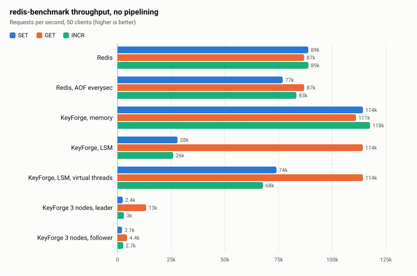
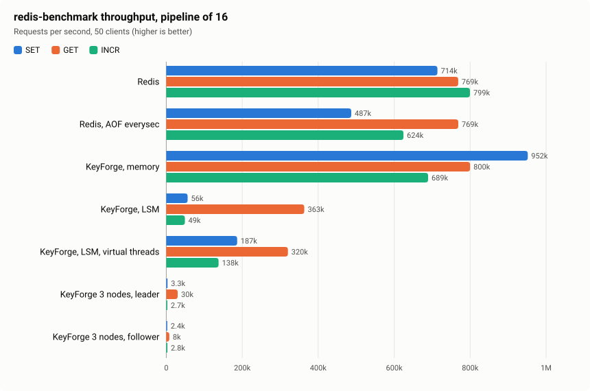
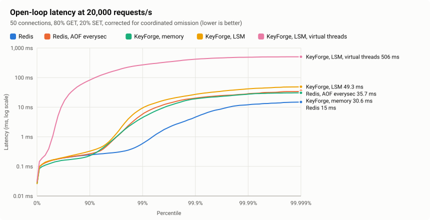
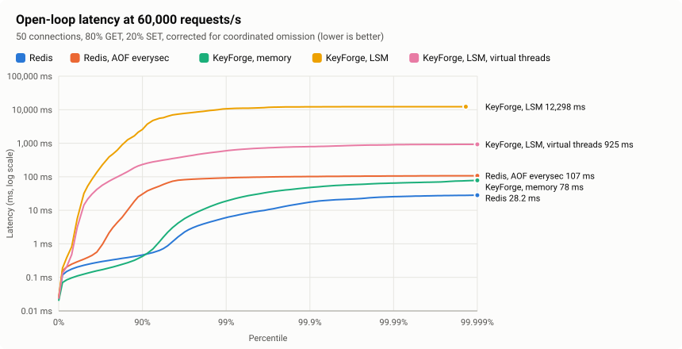
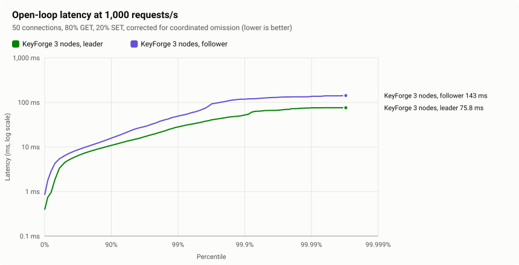

# KeyForge vs Redis

Phase 6 measures KeyForge against real Redis on the same machine, with `redis-benchmark` for throughput and an
open-loop load generator for latency that does not hide stalls (coordinated omission). The method, and why it is built
this way, is in [ADR 0018](../adr/0018-benchmarking-against-redis.md). This document is the result: the numbers, and an
analysis of the gap that rests on CPU accounting and JFR profiles rather than on guesses.

**Read this first.** One desktop, two vCPUs per side, inside Docker Desktop on Windows (setup at the end). Every
measurement ran twice (two full passes: 84 redis-benchmark runs and 28 open-loop runs, with no error replies and no dropped connections). Throughput, CPU per
request and medians reproduce between passes. Whole-run tail latencies do not: in 10 of the 14 open-loop cells, the two
passes' p99 differ by more than 5×, for Redis as much as for KeyForge. Redis is therefore the control here: what it
shows at a given rate is what this machine adds.

## Summary

| | Redis 8 | KeyForge |
| --- | --- | --- |
| Throughput, no pipelining, in memory | 60–89k req/s on one thread | **111–121k req/s** (about 40% more), using both vCPUs |
| Throughput, pipeline of 16, in memory | 644–800k req/s | 689–952k req/s, −14% to +48% per command |
| Server CPU per request, in memory | **11–15 µs** unpipelined, **1.2–1.6 µs** pipelined | 14–15 µs (1.0–1.3×), 2.0–2.8 µs (1.3–2.3×) |
| Durable `SET`, no pipelining | 77–78k/s (AOF, fsync every second) | 28k/s behind Netty, **73–74k/s behind virtual threads** (LSM, group commit) |
| Durable `SET`, pipeline of 16 | 476–487k/s (AOF) | 56k/s Netty, 185–187k/s virtual threads |
| Replicated `SET` (three nodes, one machine) | n/a | 1.9–2.4k/s on the leader; `GET` 12–13k/s |
| Median latency at 20k and 60k req/s | 0.16–0.27 ms | 0.12–0.17 ms (in memory) |
| Typical-second p99 at 20k req/s | **0.45–0.65 ms** | 2.7–7.3 ms in memory, 4.1–4.4 ms LSM (Netty) |
| Typical-second p99 at 60k req/s | 2.2–4.3 ms | 7.7–9.2 ms in memory; the LSM engine falls behind |

In one sentence: **KeyForge's in-memory node serves more requests than Redis by using a second core, at a median
latency that is just as low; per request it spends 1.0–2.3× Redis's CPU, its tail is several times longer because of
GC pauses, durable writes cost it a thread hand-off per batch that Redis does not pay, and consensus costs two fsyncs and
a network round trip per write.**

## Throughput (redis-benchmark)

50 clients, 64-byte values, 100,000 random keys, two redis-benchmark threads; 1,000,000 requests per command without
pipelining and 5,000,000 with a pipeline of 16 (30,000 for the cluster), after an untimed warm-up. Charts from pass 1;
pass 2's are in [results/2026-11-03/redis-comparison/pass-2/charts](results/2026-11-03/redis-comparison/pass-2/charts).





Requests per second, `pass 1 / pass 2`, and the server CPU per request (all server containers of the target, over the
run, divided by its requests):

| Target | Pipeline | SET | GET | INCR | CPU per request (SET / GET / INCR, µs) |
| --- | ---: | ---: | ---: | ---: | ---: |
| Redis | 1 | 88.9k / 79.9k | 86.9k / 60.4k | 88.9k / 83.3k | 11.1 / 11.4 / 11.2 |
| Redis, AOF everysec | 1 | 76.9k / 78.4k | 86.9k / 86.9k | 83.3k / 81.6k | 13.0 / 11.5 / 12.0 |
| KeyForge, memory | 1 | 114k / 111k | 111k / 114k | 118k / 121k | 14.7 / 14.9 / 14.4 |
| KeyForge, LSM (Netty) | 1 | 28.0k / 28.4k | 114k / 84.6k | 25.9k / 26.0k | 56.6 / 16.0 / 60.5 |
| KeyForge, LSM, virtual threads | 1 | 74.0k / 72.7k | 114k / 121k | 67.7k / 67.8k | 24.3 / 16.2 / 24.3 |
| KeyForge 3 nodes, leader | 1 | 2.44k / 1.93k | 13.3k / 12.0k | 2.99k / 2.92k | 616 / 131 / 350 |
| KeyForge 3 nodes, follower | 1 | 2.10k / 1.10k | 4.44k / 4.44k | 2.66k / 1.53k | 775 / 416 / 485 |
| Redis | 16 | 714k / 644k | 769k / 766k | 799k / 769k | 1.39 / 1.25 / 1.22 |
| Redis, AOF everysec | 16 | 487k / 476k | 769k / 800k | 624k / 605k | 2.26 / 1.26 / 1.69 |
| KeyForge, memory | 16 | 952k / 952k | 800k / 741k | 689k / 714k | 1.97 / 2.47 / 2.77 |
| KeyForge, LSM (Netty) | 16 | 56.3k / 55.8k | 363k / 289k | 48.9k / 49.7k | 23.4 / 5.33 / 27.0 |
| KeyForge, LSM, virtual threads | 16 | 187k / 185k | 320k / 392k | 138k / 146k | 8.21 / 5.81 / 10.8 |
| KeyForge 3 nodes, leader | 16 | 3.33k / 3.15k | 29.9k / 29.9k | 2.72k / 3.33k | 332 / 59.9 / 336 |
| KeyForge 3 nodes, follower | 16 | 2.44k / 1.68k | 7.98k / 7.48k | 2.85k / 2.39k | 431 / 214 / 396 |

CPU per request is pass 1's; pass 2's is within 10% except where its throughput dropped (Redis `GET` without
pipelining: 15.0 µs). Raw rows: `pass-1/redis-benchmark.csv`, `pass-2/redis-benchmark.csv`.

## Latency (open loop, corrected for coordinated omission)

KeyForge's load generator (Phase 2) against every target, Redis included: 50 connections, one request in flight each,
80% `GET` and 20% `SET` of 64-byte values over 100,000 keys, at a fixed offered rate. Every latency is measured from
the request's *intended* send time, so a stall counts against every request it delays. 10 s of warm-up, then 30 s
measured. The percentile spectra stretch the x axis as `log10(1 / (1 - p))`, so the tail gets as much room as the
median.







Milliseconds, `pass 1 / pass 2`. *Median 1-s p99* is the median of the 30 per-second p99s: the tail of a typical second,
which an isolated stall cannot move.

| Target | Offered (req/s) | p50 | Median 1-s p99 | p99 | p99.9 | max |
| --- | ---: | ---: | ---: | ---: | ---: | ---: |
| Redis | 20,000 | 0.165 / 0.161 | 0.449 / 0.647 | 0.593 / 5.44 | 4.64 / 14.8 | 15.5 / 27.5 |
| Redis, AOF everysec | 20,000 | 0.163 / 0.165 | 1.22 / 0.961 | 5.86 / 2.40 | 20.3 / 15.5 | 38.3 / 27.8 |
| KeyForge, memory | 20,000 | 0.135 / 0.168 | 2.72 / 7.26 | 4.50 / 35.6 | 19.3 / 88.7 | 31.2 / 143 |
| KeyForge, LSM (Netty) | 20,000 | 0.167 / 0.161 | 4.44 / 4.06 | 9.48 / 8.72 | 27.2 / 21.1 | 52.0 / 29.7 |
| KeyForge, LSM, virtual threads | 20,000 | 1.09 / 0.192 | 69.4 / 2.87 | 269 / 6.31 | 419 / 22.5 | 508 / 38.5 |
| Redis | 60,000 | 0.231 / 0.271 | 2.18 / 4.33 | 6.07 / 121 | 17.5 / 170 | 29.0 / 194 |
| Redis, AOF everysec | 60,000 | 0.351 / 0.287 | 10.4 / 5.56 | 92.5 / 12.6 | 102 / 21.0 | 109 / 29.9 |
| KeyForge, memory | 60,000 | 0.125 / 0.121 | 7.69 / 9.23 | 18.8 / 14.1 | 47.8 / 29.0 | 82.8 / 64.4 |
| KeyForge, LSM (Netty) | 60,000 | 31.8 / 2.46 | 9,106 / 6,365 | 10,620 / 6,375 | 12,163 / 6,895 | 12,298 / 7,160 |
| KeyForge, LSM, virtual threads | 60,000 | 14.3 / 1,085 | 97.8 / 1,416 | 596 / 3,163 | 791 / 3,324 | 929 / 3,370 |
| KeyForge 3 nodes, leader | 500 | 3.03 / 2.93 | 15.4 / 17.3 | 126 / 23.6 | 170 / 38.6 | 189 / 54.0 |
| KeyForge 3 nodes, follower | 500 | 5.19 / 6.52 | 29.3 / 34.3 | 58.8 / 758 | 116 / 989 | 146 / 1,056 |
| KeyForge 3 nodes, leader | 1,000 | 4.50 / 6.50 | 21.0 / 36.9 | 28.0 / 1,876 | 52.6 / 2,002 | 75.8 / 2,037 |
| KeyForge 3 nodes, follower | 1,000 | 6.39 / 8.01 | 26.8 / 28.5 | 49.7 / 1,023 | 118 / 1,282 | 143 / 1,341 |

Full distributions: `pass-*/<target>-50c-<rate>rps.hgrm`; per-second output: `pass-*/<target>-50c-<rate>rps.log`;
both passes' tables: `pass-*/charts/summary.md`.

## Analysis of the gap

### 1. In memory, KeyForge wins throughput by using more cores, and loses on CPU per request

Without pipelining, every request costs a `read`, a `write` and a wake-up on both sides, so the kernel's network path
dominates for both servers: Redis spends 11–15 µs of CPU per request, most of it in system time. Redis runs commands on
one thread; KeyForge runs them on four Netty event loops over the two vCPUs. With 50 clients, that gives KeyForge
111–121k req/s against Redis's 60–89k, about 40% more, and only because it can use the second vCPU. Per request it
spends about the same CPU unpipelined (14–15 µs, 1.0–1.3× Redis), because the kernel's share is the same.

With a pipeline of 16 the kernel's share shrinks to almost nothing, and the user-space cost shows: Redis needs 1.2–1.6
µs per request, KeyForge 2.0–2.8 µs (1.3–2.3×). Its throughput is still similar (689–952k against 644–800k, −14% to +48% per command), again
because it has twice the cores to spend. A JFR profile of the in-memory node under redis-benchmark (`settings=profile`)
shows where the user-space time goes:

- **The hash lookup: 23% of the Java samples**, all in `InMemoryKeyValueStore$Key.equals` called from `HashMap.get`.
  The keys' hashes are distinct and checked first, so this is not chaining. It is memory latency: 100,000 random keys,
  with their `HashMap` nodes, `Key` objects, key and value arrays and entries, are a working set of about 20 MB,
  more than three times this CPU's 6 MB L3 cache, and the comparison is the first touch of the stored key's bytes. Redis's dictionary chases pointers
  too; it allocates less around each entry.
- **Per-reply buffers: about 15%**: Netty's pooled-buffer allocation for every reply (`AdaptivePoolingAllocator`) and
  the outbound buffer's bookkeeping (`ChannelOutboundBuffer`). ADR 0004 deferred encoding a whole batch into one
  buffer "for profiling (Phase 6)". The profile says it is worth doing for pipelined clients: 16 replies would share
  one buffer and one outbound entry. It is not done in this phase (open issue).
- **Allocation, and therefore GC.** By allocation pressure: `byte[]` 29% (request arguments copied out of the network
  buffer, inherent to the `byte[][]` request model), `DirectByteBuffer` 25% (a `ByteBuf.nioBuffer()` view created per
  read by the frame decoder), `HeapByteBuffer` 9.5% (`RespNumbers.parseLong(byte[])` wraps its argument), `byte[][]`
  6%, and JDK NIO's per-write `IOUtil` objects. The last three are cheap to remove; Netty's native epoll transport would
  also remove the JDK's NIO layer (Phase 2's open issue). Redis allocates almost nothing per request.

### 2. KeyForge's tail latency is GC

At moderate load KeyForge's median is as low as Redis's, or lower: 0.12–0.17 ms against 0.16–0.27 ms, because two
cores serve 50 connections with less queueing than one thread does. The tail is another matter. In a typical second at
20k req/s, Redis's p99 is 0.45–0.65 ms and KeyForge's 2.7–7.3 ms; at 60k, 2.2–4.3 ms against 7.7–9.2 ms. The profiled
redis-benchmark run had 70 young-generation pauses, with a median of 13 ms and a p99 of 51 ms on these two vCPUs; any request
that arrives during one waits for it, and the open loop counts them all. With the LSM engine the heap also holds the
64 MiB memtable, a skip list that the writer keeps mutating: 533 pauses, a p99 of 96 ms. Redis has no collector.

Removing per-request garbage (above) shortens and spaces out those pauses; a lower-pause collector does not help on two
vCPUs, where its concurrent threads compete with the server (Phase 2 tried ZGC on the servers: the tails did not shrink).

Whole-run p99 and beyond say little here, for Redis as much as for KeyForge: Redis's p99 at 60k was 6 ms in pass 1 and
121 ms in pass 2; Redis with AOF went the other way, 92 ms and then 13 ms. Phase 2 measured this machine's jitter floor
at 10–20 ms, with stalls that hit every process at once; a 2-second stall in an open loop shows as hundreds of
milliseconds at p99.

### 3. Durable writes: a thread hand-off per batch, and Netty's event loops wait for it

Redis with `appendfsync everysec` appends each write to an in-memory buffer on its single thread and writes the buffer
to the file once per event-loop iteration, before replying; a background thread fsyncs once a second. A write costs it
1–2 µs of extra CPU (13.0 against 11.1 µs unpipelined).

KeyForge's LSM engine is safer by default (group commit: an fsync at most every 10 ms) and works differently: one
writer thread evaluates every mutation, encodes the WAL record, inserts the new version into the memtable, writes the
batch, and wakes the callers (ADR 0006, ADR 0007). The caller parks on a future until then. That design costs:

- **Behind Netty, a parked caller is a parked event loop.** Four event loops mean at most four writes in flight, so
  the writer's batches hold four writes at most: 28k `SET`/s unpipelined at 57 µs of CPU each, mostly the hand-off
  (two thread wake-ups per batch) and the per-batch `write` call. `GET`s on the same event loop wait behind the `SET`s.
  This is Phase 3's open issue ("Netty event loops block while their write is committed"), now measured.
- **Behind virtual threads, a parked caller is a parked virtual thread,** and the other 49 connections keep sending:
  batches grow to dozens of writes, and `SET` reaches 73–74k/s at 24 µs, 4–7% below Redis with AOF. Pipelined, the
  virtual-thread server reaches 185–187k `SET`/s, about 40% of Redis's 476–487k: each connection still waits for its
  write before decoding the next request, and the writer inserts every version into a skip list (42% of the Java
  samples in the LSM profile are `ConcurrentSkipListMap` inserts and their key comparisons).
- **Under the mixed open loop at 60k req/s, both LSM configurations fall behind** (12k `SET`/s offered): the Netty
  server because `GET`s queue behind blocked event loops, the virtual-thread server with a median of 14 ms in pass 1 and
  1.1 s in pass 2. At 20k req/s both keep up, the Netty one with a typical-second p99 of 4.1–4.4 ms.

An asynchronous store API, in which an event loop hands the write over and moves on to its other connections, is the
fix for the first point; group commit across connections already exists in the engine.

The virtual-thread server at 20k req/s had queueing episodes in pass 1 (p50 rising to 95 ms for five seconds at a
time, twice in the run) with no matching GC pause or load-generator lag; pass 2 did not have them. A third run, recorded
with JFR, did not either (p50 0.20 ms, typical-second p99 3.2 ms, p99 7.6 ms), and recorded no pinned virtual thread and
no failed scheduler submission. One run in three is not explained; Phase 2 saw unexplained median rises of the
virtual-thread server under load too, and both need a recording of an episode while it happens.

### 4. Consensus: two fsyncs and a round trip per write, three JVMs on two vCPUs

A replicated write is acknowledged once a majority has it in its Raft log on disk: the leader appends and fsyncs, a
follower receives it over gRPC, appends and fsyncs, the leader learns of it, commits, applies it to its LSM store and
replies. With all three nodes on the same two vCPUs and the same virtual disk:

- **Writes:** 1.9–2.4k `SET`/s on the leader, 30 to 40 times fewer than Redis with AOF, at 600 µs of CPU per write
  across the three nodes. 50 clients give batches of up to 50 entries per fsync (ADR 0009); an fsync on this virtual
  disk takes milliseconds. Pipelining does not help (3.1–3.3k/s): a connection's commands wait for their commits one
  after another.
- **Reads:** 12–13k `GET`/s on the leader, a ReadIndex round (a heartbeat exchange with a majority) per batch of reads;
  4.4k on a follower, which forwards every data command to the leader (ADR 0014) and pays the extra hop.
- **Latency at 500 and 1,000 req/s:** a median of 3–8 ms, a typical-second p99 of 15–37 ms. Pass 2 had a 4-second
  throughput dip at 1,000 req/s (40–75% of the offered rate) with no election, no GC pause over 11 ms and nothing in the
  nodes' logs, which put its whole-run p99 at 1–2 s. A stall of the shared virtual disk's fsyncs is the likely cause;
  the nodes do not measure fsync latency yet (open issue), so it is not confirmed.

Redis has no counterpart in these runs: its replication is asynchronous, so an acknowledged write can be lost when the
primary fails, which Raft rules out. Redis with `WAIT 1` after every write would be the closer comparison; it was not
measured.

### 5. What is not the gap

- **The protocol and the front end.** At moderate load the medians are equal or better than Redis's, and without
  pipelining the CPU per request is within 30%: the RESP codec, the command table and Netty are not where the time goes.
- **Durability per se.** With the virtual-thread front end, durable unpipelined writes are within 4–7% of Redis with AOF,
  with a stricter fsync policy (10 ms against 1 s).

## Profile-driven fix in this phase

The LSM profile showed `String.valueOf` in 2% of the samples, from `SSTable.get`: every point lookup that passed the
Bloom filter built the string `path + " block " + n`, only to name the block in a `CorruptionException` that is almost
never thrown. The name is now a small record whose `toString()` runs only when an error message needs it. Measured with
`LsmGetBenchmark.getHit` (`location=sstable`, 3 forks × 5 iterations, `-prof gc`,
[results/2026-11-03/jmh](results/2026-11-03/jmh)):

| | Allocation per lookup | Time per lookup |
| --- | ---: | ---: |
| Before | 4,608 B | 2,212 ± 476 ns |
| After | 4,456–4,496 B (−3%) | 1,947 ± 253 ns |

The allocation saving is exact; the time difference is within this desktop's noise. The remaining 4.5 KB per lookup is
the 4 KiB data block, copied out of the memory-mapped file into a fresh array before its CRC is checked and it is
parsed. Reading the block in place (a `MemorySegment` slice) would remove nearly all of it; that is a larger change and
an open issue.

## Cost of metrics

Every number above was measured with metrics off (`metrics.port=0`, the default), so the dispatcher reads no clock. With
them on, every command is timed into a Prometheus histogram ([ADR 0019](../adr/0019-metrics-and-dashboard.md)). One
back-to-back run of the in-memory node each way
([results/2026-11-03/metrics-overhead](results/2026-11-03/metrics-overhead)):

| | Off | On | Change |
| --- | ---: | ---: | ---: |
| CPU per request, no pipelining (SET / GET / INCR) | 14.8 / 14.4 / 14.2 µs | 14.6 / 15.5 / 15.4 µs | −2% to +9% |
| CPU per request, pipeline of 16 | 1.95 / 2.45 / 2.45 µs | 2.51 / 2.73 / 3.04 µs | +11% to +29% |
| Throughput, pipeline of 16 | 1.00M / 799k / 767k | 769k / 713k / 624k | −11% to −23% |

Unpipelined, the difference is within the noise of a single run. Pipelined, it is not: about 0.3 to 0.6 µs per command,
two clock reads in this VM plus the histogram update, against 2 to 2.5 µs of work. That is acceptable for a node that
is being watched, and the reason metrics stay off by default and off in the comparison above. Sampling the timer, or
recording into a per-thread histogram merged at scrape time, would cut it (open issue).

## Threats to validity

- **Environment.** Docker Desktop on Windows: the Linux VM's vCPUs are scheduled by Hyper-V alongside the host, the
  jitter floor is 10–20 ms, and fsyncs go through a virtual disk on a DRAM-less SATA SSD.
- **Scale.** Two vCPUs per side. KeyForge's throughput advantage in memory exists only because it has a second core to
  use; with one core it would be behind Redis by the CPU-per-request ratio. Redis 8 can also use I/O threads
  (`io-threads`), which these runs leave at the default (off).
- **Samples.** Two passes per cell, plus the experiments described above. Tails that differ between passes are not
  claimed.
- **Clients.** redis-benchmark with two threads on two vCPUs; at 950k req/s it is close to its own limit, so the
  pipelined in-memory numbers may understate both servers. The load generator records its own timer lag
  (`timer_lag_*` in `latency.csv`): p99 0.14–2.8 ms in every run.
- **Workload.** 64-byte values, 100,000 keys, single-key commands, one database size. Larger values, a larger keyspace
  (beyond the memtable) and SSTable reads would shift the LSM numbers.
- **The cluster** puts three nodes on two vCPUs and one disk: consensus at its most concentrated, not a deployment.

## Setup

**Machine.** A Windows 10 desktop: Intel Core i3-9100F (4 cores, 3.6 GHz, no SMT), 16 GiB of RAM, a Kingston A400 SATA
SSD. Everything runs in Linux containers under Docker Desktop 29.6.1 (WSL 2 VM: 4 vCPUs, 7.7 GiB, kernel 5.15.167).
Redis 8.10.3 from the `redis:8` image; KeyForge on `eclipse-temurin:25-jdk` (Temurin 25.0.4.1), jars built with
Temurin 25.0.5.

**Isolation.** Servers are pinned to vCPUs 0–1 (`--cpuset-cpus`), clients to vCPUs 2–3. Each target starts fresh in
its own container, on one Docker bridge network; nothing crosses Docker Desktop's port proxy. The three cluster nodes
share vCPUs 0–1.

**Servers.** Redis: `--save "" --appendonly no`, or `--save "" --appendonly yes --appendfsync everysec`, and defaults
otherwise. KeyForge: `-Xmx2g -XX:+UseG1GC`; Netty (4 event loops) or virtual threads (2 carriers); `store.engine=memory`
or `lsm` with group commit (fsync every 10 ms or 1 MiB); the cluster with virtual threads and the LSM engine. Metrics
off (`metrics.port=0`).

**Clients.** redis-benchmark from the `redis:8` image, in a long-lived container. The load generator runs on ZGC with
two Netty epoll event loops; it prepopulates the keys with `MSET`s of 100 keys.

## Reproducing

```bash
./mvnw -q package -DskipTests
keyforge-bench/scripts/compare-with-redis.sh
```

Variables at the top of the script choose the targets, request counts, rates and CPUs. A full pass takes about 30
minutes. `REPORT_ONLY=1 OUT=<results>` redraws the charts and tables from saved results; `PROFILE=1` records a JFR file
for every KeyForge server; `SERVER_ARGS` passes options to every KeyForge server.
